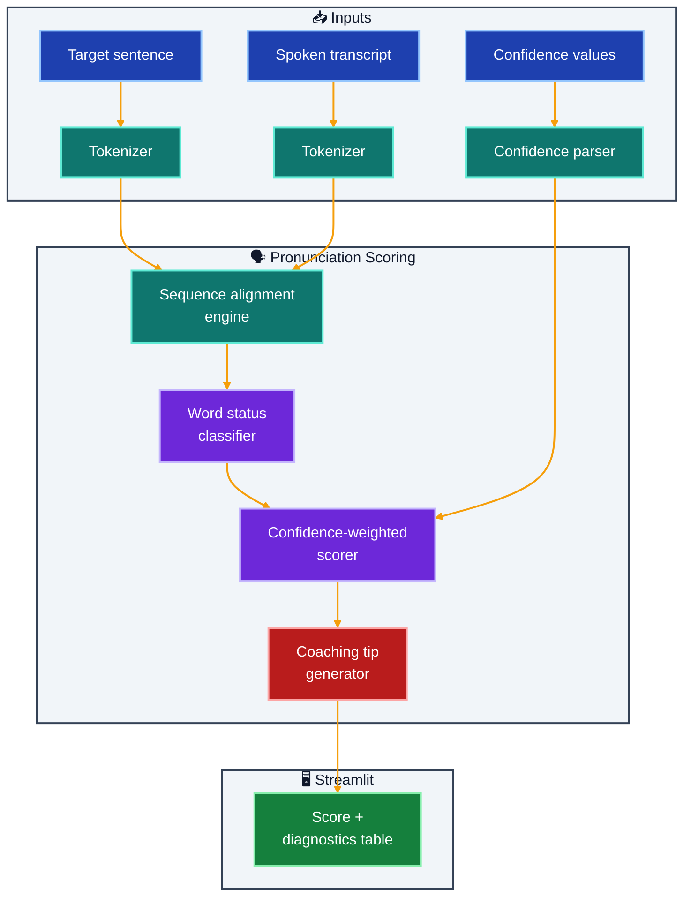

# PronounceRight

Pronunciation scoring starter app with logging-enabled feedback generation.

## What It Does

- Compares target sentence words against spoken transcript words
- Uses confidence-weighted token alignment for scoring
- Outputs word-level diagnostics (correct/substituted/missed)
- Generates focused coaching tips from weak pronunciations

## Implemented Feature Slice

- Token-level alignment between target sentence and spoken transcript
- Confidence-weighted pronunciation scoring (0-100)
- Word-level diagnostics: correct/substituted/missed
- Actionable coaching tips based on weak words and misses
- Streamlit table output for detailed feedback

## Architecture



## Outcome

- Produces objective pronunciation feedback at word level
- Makes practice measurable with a repeatable score
- Guides learners with actionable, targeted pronunciation advice

## Quick Start

### Prerequisites

- [UV](https://docs.astral.sh/uv/) installed (`powershell -c "irm https://astral.sh/uv/install.ps1 | iex"` on Windows)

### Run Locally

```bash
cd pronounceright
uv sync

uv run streamlit run app.py
```

Open [http://localhost:8501](http://localhost:8501) in your browser.

---

## Project Structure

```
pronounceright/
├── app.py                  # Streamlit entry point — target, transcript, confidence inputs + score + table + tips
├── services/
│   ├── __init__.py
│   └── core.py             # Tokenizer, alignment engine, word classifier, scorer, tip generator
├── .streamlit/
│   └── config.toml         # App theme
├── pyproject.toml          # UV dependencies
└── README.md
```

---

## Logging

- Logging is configured on startup.
- Use LOG_LEVEL to adjust verbosity.
